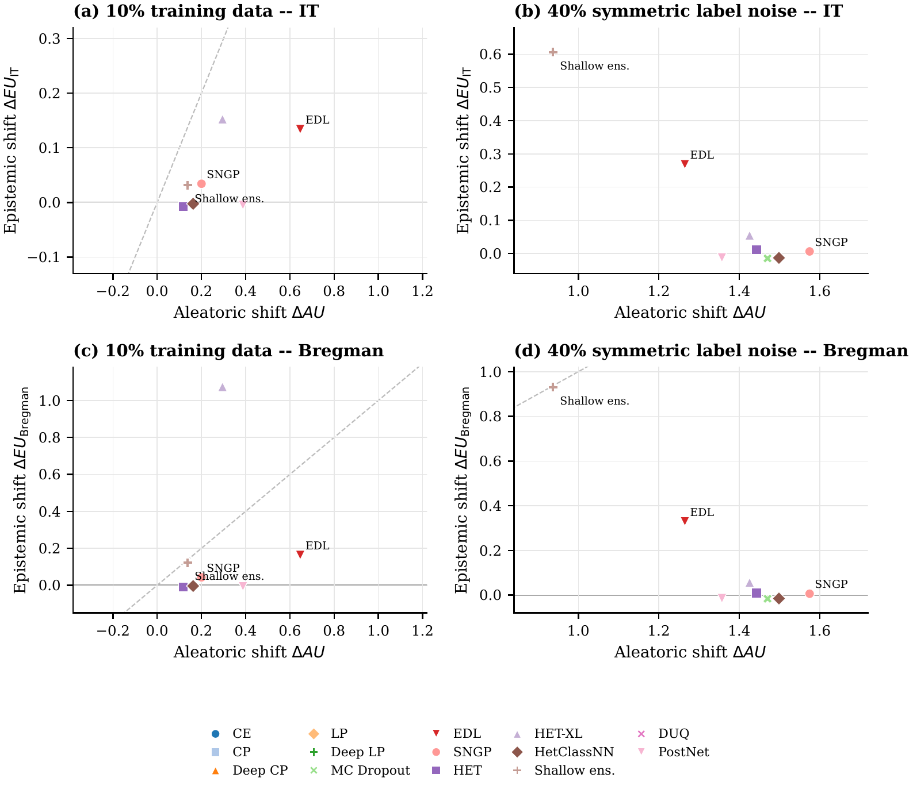

# Medical Image Uncertainty Disentanglement

This repository contains the experiment code and reference results for evaluating
aleatoric and epistemic uncertainty estimates in medical image classification. It
extends the uncertainty-disentanglement benchmark by Mucsanyi et al. with
PathMNIST, PathMNIST-C, and MHIST experiments, while retaining a CIFAR-10
reproduction as an implementation check.

The central question is whether uncertainty components respond selectively to
controlled sources of uncertainty, rather than merely producing useful predictive
uncertainty scores.

## Bachelor Thesis

**Exploring the Applicability of Uncertainty Disentanglement for Medical Image
Classification**

Florian Weigl, University of Bamberg, 2026

[Read the thesis](thesis/Florian_Weigl_Bachelor_Thesis.pdf)

The thesis examines whether uncertainty estimates in medical image
classification distinguish between different sources of uncertainty instead of
only identifying difficult predictions. After reproducing an established
CIFAR-10 benchmark, the evaluation is transferred to PathMNIST and MHIST.
Controlled experiments use training-label noise as an aleatoric probe, reduced
training data as an epistemic probe, image corruptions as a distribution-shift
probe, and pathologist disagreement as a proxy for diagnostic ambiguity. Label
noise produces the clearest source-specific response, while data scarcity,
corruption, and rater disagreement often affect both uncertainty components or
move them in an unexpected direction. Useful uncertainty scores therefore do
not necessarily provide a reliable explanation of why a medical image is
uncertain.



*Aleatoric and epistemic uncertainty changes for PathMNIST under reduced
training data and 40% symmetric training-label noise, shown for the
information-theoretic and Bregman decompositions. Label noise mainly increases
the aleatoric component, whereas reduced training data often fails to produce
the expected epistemic-dominant response.*

The linked PDF is a public-distribution edition. Four MHIST source images are
omitted because the MHIST Dataset Research Use Agreement does not permit their
republication without written permission; the thesis text and results are
otherwise unchanged.

## Experiment Scope

| Dataset | Probe | Intended evidence |
|---|---|---|
| CIFAR-10 / CIFAR-10C | Benchmark reproduction, data scarcity, corruption | Agreement with the upstream workflow and reference results |
| PathMNIST | Training-label noise at 10%, 20%, and 40% | Aleatoric response |
| PathMNIST | Training subsets at 50% and 10% | Epistemic response to reduced evidence |
| PathMNIST-C | Eight corruption types; fixed official corruptions and generated severities 1-5 | Detection of distribution shift |
| MHIST | Entropy of seven pathologist votes | Association with label ambiguity |
| MHIST | Training subsets at 50% and 10% | Epistemic response to reduced evidence |

Where predictive samples are available, analyses report both the
information-theoretic and Bregman decompositions. Methods with only one
deterministic predictive distribution do not yield an independently measured
epistemic component; result tables leave such values undefined instead of treating
zero as evidence of certainty.

## Repository Layout

```text
untangle/                 Models, wrappers, losses, datasets, and transforms
configs/                  Portable command and checkpoint-manifest templates
tools/hpc/                PathMNIST SLURM command generation and pipelines
tools/launchers/          Reconstructed CIFAR-10 launchers
tools/run_mhist_*.sh      MHIST experiment queues
tools/analyze_*.py        Result extraction and decomposition analysis
docs/results/             Lightweight reference result tables
docs/wandb_sweeps/        Recovered upstream sweep configurations
train.py                  Training and evaluation entry point
validate.py               Metrics and uncertainty decomposition logic
```

## Installation

Python 3.11 or 3.12 is supported. A CUDA-enabled PyTorch installation is
recommended for training.

```bash
python -m venv .venv
source .venv/bin/activate
python -m pip install --upgrade pip
python -m pip install -e '.[dev]'
pytest
```

Image corruptions use Wand, which requires a system installation of ImageMagick.
The supplied `Singularity` definition provides an alternative container starting
point for cluster execution.

## Data Setup

Downloaded datasets are kept outside Git. Set a local root before running the
examples:

```bash
export DATA_ROOT=/path/to/datasets
```

Export PathMNIST to the expected image-folder layout:

```bash
python tools/export_medmnist_to_imagefolder.py \
  --download \
  --output-dir "$DATA_ROOT/pathmnist_cache"
```

For MHIST, provide the temporary download URLs issued after accepting the dataset
terms:

```bash
python tools/prepare_mhist.py \
  --root "$DATA_ROOT/MHIST" \
  --images-url "$MHIST_IMAGES_URL" \
  --annotations-url "$MHIST_ANNOTATIONS_URL" \
  --md5-url "$MHIST_MD5_URL"
```

See [PathMNIST export notes](docs/PATHMNIST_EXPORT.md) and
[MHIST integration](docs/MHIST_INTEGRATION.md) for the expected layouts.

## Running Experiments

The PathMNIST command generator covers full-data training, scarcity, label noise,
fixed PathMNIST-C corruptions, the five-level severity axis, and post-hoc methods.
Commands can be inspected without submitting a cluster job:

```bash
python tools/hpc/generate_pathmnist_hpc_commands.py \
  --phase all \
  --output /tmp/pathmnist_commands.txt \
  --pathmnist-dir "$DATA_ROOT/pathmnist_cache/pathmnist" \
  --pathmnist-c-dir "$DATA_ROOT/pathmnist_c/pathmnist"
```

Example SLURM submissions:

```bash
DATA_ROOT="$DATA_ROOT" PHASE=train \
  bash tools/hpc/submit_pathmnist_hpc.sh

DATA_ROOT="$DATA_ROOT" \
  bash tools/hpc/submit_pathmnist_label_noise_pipeline.sh
```

CIFAR-10 launchers are under `tools/launchers/`. MHIST queues use the
`tools/run_mhist_*_queue.sh` entry points. Post-hoc methods that require trained
weights use local manifests created from the `.example` files in `configs/`.

The complete environment, data, cluster, and verification instructions are in
[REPRODUCIBILITY.md](REPRODUCIBILITY.md).

## Results and Analysis

Versioned reference tables are grouped by dataset:

- [CIFAR-10 results](docs/results/cifar10/)
- [PathMNIST results](docs/results/pathmnist/)
- [MHIST results](docs/results/mhist/)
- [Cross-dataset decomposition comparison](docs/results/decomposition_formula_comparison.csv)

Core analysis entry points include:

```bash
python tools/analyze_pathmnist_hpc_results.py --help
python tools/analyze_mhist_disentanglement.py --help
python tools/compare_decomposition_formulas.py
python tools/summarize_pathmnist_severity_axis.py --help
python tools/summarize_cifar10_posthoc_outputs.py --help
```

The CSV files are compact reference outputs. Raw checkpoints, uncertainty tensors,
dataset copies, and scheduler logs are generated locally and are not versioned.

## Provenance and Citation

The software began as a fork of
[bmucsanyi/untangle](https://github.com/bmucsanyi/untangle). The upstream project
implements the benchmark introduced in:

```bibtex
@article{mucsanyi2024benchmarking,
  title={Benchmarking Uncertainty Disentanglement: Specialized Uncertainties for Specialized Tasks},
  author={Mucs{\'a}nyi, B{\'a}lint and Kirchhof, Michael and Oh, Seong Joon},
  journal={arXiv preprint arXiv:2402.19460},
  year={2024}
}
```

The medical-image extensions and reproducibility package are maintained by
Florian Weigl. Historical sweep YAMLs retain upstream W&B identifiers and original
machine paths for provenance; use the portable launchers and local manifest
templates for new runs.

## License

Source code is licensed under the Apache License 2.0; see [LICENSE](LICENSE).
The original thesis text, original thesis figures, and pull figure are licensed
under CC BY 4.0; see [THESIS_LICENSE.md](THESIS_LICENSE.md). Third-party material
retains its original terms. Original copyright and attribution notices are
retained.
